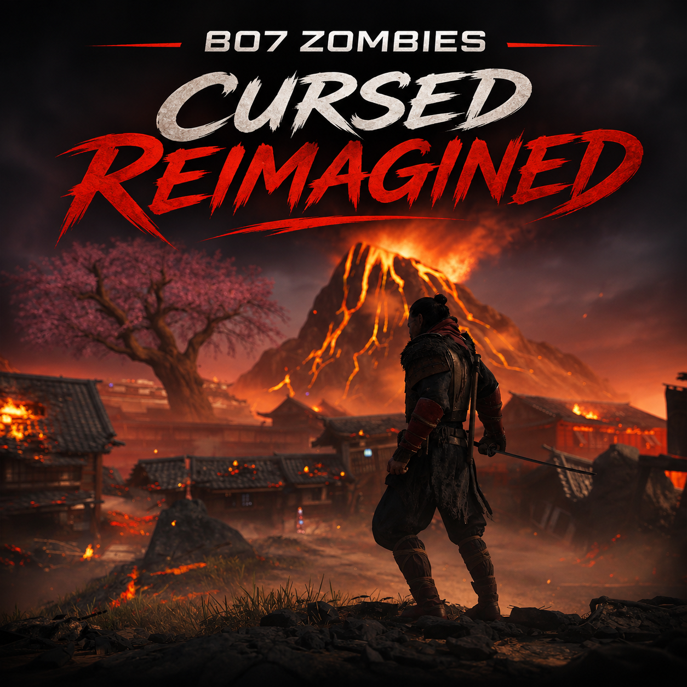

# BO7 Zombies | Cursed Reimagined

A classic-inspired gameplay overhaul for **Call of Duty: Black Ops 7 Zombies**, designed for the **Kronos offline client**.

Cursed Reimagined brings back elements of classic Zombies while preserving BO7's modern gameplay systems. It reworks weapon progression, Pack-a-Punch, armor, perks, melee combat, and Field Upgrades to deliver a more challenging and traditional Zombies experience.

## Supported Game Modes

- **Cursed**
- **Cursed Survival**
- **Mister Peeks Mayhem**

The mod is designed specifically for these three modes and does not intentionally modify Standard Zombies or Directed Mode.

---

## Features

### 1. Combined Pack-a-Punch & Weapon Rarity

Weapon rarity now increases automatically when using Pack-a-Punch, eliminating the need to upgrade rarity separately through the Arsenal.

| Weapon State | Rarity | Pack-a-Punch Cost |
|---|---|---|
| Starting 1911 | White / Common | — |
| Wall-Buy & Mystery Box Weapons | Green / Uncommon | — |
| Pack-a-Punch I | Blue / Rare | 5,000 |
| Pack-a-Punch II | Purple / Epic | 20,000 |
| Pack-a-Punch III | Gold / Legendary | 35,000 |
| Pack-a-Punch IV | Red / Ultra | 50,000 |

Rarity upgrades are included with each Pack-a-Punch purchase at no additional Salvage cost.

### 2. Mystery Box Overhaul

The Mystery Box has been adjusted to provide more consistent weapon progression.

- Regular weapons always appear at **Green / Uncommon rarity**, regardless of the round.
- Blue, Purple, and Gold regular weapon rolls are disabled.
- Aether Tools are removed from the loot pool.
- Ultra Legacy Weapons remain available through their separate loot system.
- The mod includes experimental support for obtaining map-specific Wonder Weapons without completing their respective quests.

### 3. Wall-Buy Changes

- All regular wall-buy weapons remain **Green / Uncommon rarity**.
- Weapon rarity no longer increases as rounds progress.
- Purchased weapons can still be upgraded through Pack-a-Punch.

### 4. Arsenal Rework

The Arsenal has been repurposed to provide Ammo Mods instead of weapon rarity upgrades.

- **Random Ammo Mod:** 250 Salvage.
- Each successful purchase applies a randomly selected compatible Ammo Mod.
- Existing Ammo Mods can be replaced through another purchase.
- Manual weapon rarity upgrades are disabled.
- Custom Arsenal interaction prompts are provided through the included Lua script.
- Wonder Weapons are excluded from the custom Ammo Mod purchase system.

### 5. Classic Armor Progression

Players begin each match **without armor** and must purchase armor upgrades from wall-buy locations.

| Armor Tier | Cost |
|---|---:|
| Tier I | 2,500 |
| Tier II | 4,000 |
| Tier III | 10,000 |
| Golden Armor | 25,000 |

Armor upgrades must be purchased progressively.

### 6. Classic Perks & Wunderfizz

The package includes a separately maintained Classic Perks script that restores BO3-inspired perk pricing, with adjustments for newer perks.

| Perk | Cost |
|---|---:|
| Juggernog | 2,500 |
| Quick Revive | 1,500 |
| Speed Cola | 3,000 |
| Stamin-Up | 2,000 |
| Deadshot Daiquiri | 1,500 |
| Death Perception | 1,500 |
| PHD Flopper | 2,000 |
| Vulture Aid | 3,000 |
| Elemental Pop | 2,500 |
| Melee Macchiato | 1,500 |
| Wisp Tea | 2,000 |

Additional perks use the prices defined in the included Classic Perks script.

**Wunderfizz:**
- Random perk for **2,500 Essence**.
- After obtaining all available perks, players can purchase **Eternal Perks for 7,500 Essence**.

### 7. Personalized Starting Weapons

Players spawn with their own saved Zombie Builds for:

- **1911 Pistol**
- **Starting Knife**

Configured blueprints, attachments where supported, and cosmetics are preserved.

For example, players can equip the **"The Classic" 1911 blueprint** by assigning it as their saved 1911 Zombie Build.

### 8. Classic 1911 Damage

The unupgraded White/Common 1911 has been adjusted to recreate the classic BO1 starting pistol strategy.

On round 1, players can use **8 leg shots followed by a knife kill** to maximize points.

This adjustment targets the starting 1911 and does not replace the normal damage system for other weapons.

### 9. Increased Early-Round Difficulty

Zombies in rounds **1–10** use the attack damage scaling normally associated with round 11.

This makes early rounds more dangerous and encourages players to be more careful with positioning and armor.

Normal damage progression resumes from round 11 onward.

### 10. No Starting GobbleGums

Players begin with **0 preloaded GobbleGums**, rather than the usual 3.

GobbleGums can still be acquired and used normally during the match.

### 11. Classic Knife System

The classic knife system is enabled through Melee Macchiato's **Mocha Maul** functionality.

- The dedicated melee weapon can be used through the melee button.
- Mocha Maul behavior is enabled automatically.
- Players can select other Melee Macchiato augments without giving up the classic knife functionality.
- The system works independently of whether Melee Macchiato has been purchased, subject to the game's weapon exclusions.

### 12. Field Upgrade Recharging

Field Upgrades use a fixed recharge requirement instead of becoming more expensive after repeated activations.

- **40 kills** are required for the standard recharge.
- The required kill count does not increase after each use.
- Special temporary recharge overrides, such as supported TEDD tasks, remain available.
