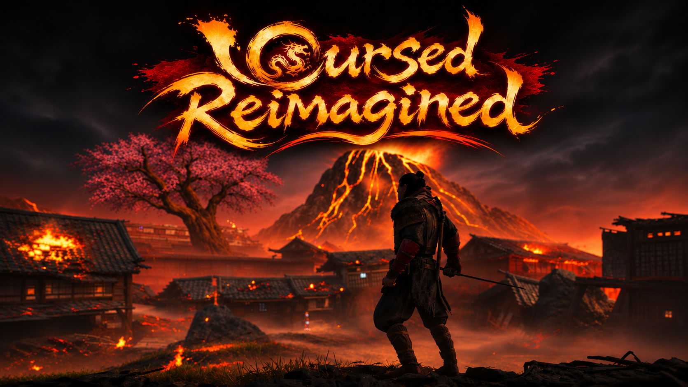

# BO7 Zombies | Cursed Reimagined

A classic-inspired gameplay overhaul for **Call of Duty: Black Ops 7 Zombies**, designed for the **Kronos offline client**.

Cursed Reimagined brings back elements of classic Zombies while preserving BO7's modern gameplay systems. It reworks weapon progression, Pack-a-Punch, armor, perks, melee combat, Wonder Weapons, enemy health scaling, Power-Ups, Field Upgrades, and Relics to deliver a more traditional Zombies experience.

> **Latest: v9.0** — Armor Rework v3, Relic Rebalance integration, and the Dancing Arnie Hard Armor rework. See [sections 5](#5-classic-armor-progression--armor-rework-v3), [20](#20-relic-rebalance-integration) and [21](#21-dancing-arnie-rework--hard-armor).

## Supported Game Modes

- **Cursed**
- **Cursed Survival**
- **Mister Peeks Mayhem**

The mod is designed specifically for these three modes and does not intentionally modify Standard Zombies or Directed Mode.

---

## Installation

1. Download **`cursed_reimagined.rar`**.
2. Extract it inside your **`kronos/mods`** folder.
3. Launch the Kronos offline client and start **Cursed**, **Cursed Survival** or **Mister Peeks Mayhem**.

**Notes**

- The mod pack already includes **Relic Rebalance**. If you installed Relic Rebalance (or its older `zm_golden_spork_rework.gsc`) on its own before, delete that copy so it doesn't run twice.
- Keep the `.lua` files from the archive: they provide the custom Arsenal prompt and the Relic Rebalance menu descriptions.
- **BO3 Health users:** use `zm_cursed_reimagined_bo3c.gsc` instead of `zm_cursed_reimagined.gsc` (see [BO3 Health Compatibility](#bo3-health-compatibility)). Never install both.
- **Uninstall:** delete the extracted files from `kronos/mods`.

---

## Features

### 1. Combined Pack-a-Punch & Weapon Rarity

Weapon rarity increases automatically when using Pack-a-Punch, removing the need to upgrade rarity separately through the Arsenal.

| Weapon State | Rarity | Pack-a-Punch Cost |
| --- | --- | --- |
| Starting 1911 | White / Common | — |
| Wall-Buy & Mystery Box Weapons | Green / Uncommon | — |
| Pack-a-Punch I | Blue / Rare | 5,000 |
| Pack-a-Punch II | Purple / Epic | 20,000 |
| Pack-a-Punch III | Gold / Legendary | 35,000 |
| Pack-a-Punch IV | Red / Ultra | 50,000 |

Rarity upgrades are included with each Pack-a-Punch purchase at no additional Salvage cost.

### 2. Mystery Box Overhaul

The Mystery Box has been adjusted to provide more consistent weapon progression and classic Wonder Weapon access.

- Regular weapons always appear at **Green / Uncommon rarity**, regardless of the round.
- Blue, Purple, and Gold regular weapon rolls are disabled.
- Aether Tools are removed from the loot pool.
- **Map-Exclusive Wonder Weapons:** Each map's exclusive Wonder Weapon can now be obtained from the Mystery Box from round 1, without completing its quest, with the same chance as the Ray Gun. Up to **4 copies** can exist at once (held or on the ground).
- **Mister Peeks Mayhem:** The Mystery Box chance of obtaining the Ray Gun or Ray Gun Mark II has been reduced by **20%**.
- Ultra Legacy Weapons remain available through their separate loot system.
- **Mystery Box Zombie Builds:** Meleeing the Mystery Box allows the weapon to retain the saved Zombie Build attachments of the player who meleed it, even if another player purchases the weapon.

### 3. Wall-Buy Changes

- All regular wall-buy weapons remain **Green / Uncommon rarity**.
- Weapon rarity no longer increases as rounds progress.
- **Classic White Chalk Outlines:** Wall-buy weapon outlines remain white regardless of weapon rarity, recreating the classic Zombies appearance.
- Purchased weapons can still be upgraded through Pack-a-Punch.

### 4. Arsenal Rework

The Arsenal has been repurposed to provide Ammo Mods instead of weapon rarity upgrades.

- **Random Ammo Mod:** 250 Salvage.
- Each successful purchase applies a randomly selected compatible Ammo Mod.
- Existing Ammo Mods can be replaced through another purchase.
- Manual weapon rarity upgrades are disabled.
- Custom Arsenal interaction prompts are provided through the included Lua script.
- Wonder Weapons are excluded from the custom Ammo Mod purchase system.

### 5. Classic Armor Progression & Armor Rework v3

Players begin each match **without armor** and must purchase armor upgrades from wall-buy locations.

| Armor Tier | Cost |
| --- | --- |
| Tier I | 2,500 |
| Tier II | 4,000 |
| Tier III | 10,000 |
| Golden Armor | 25,000 |

Armor upgrades must be purchased progressively.

**Armor Rework v3 (Standard Version)**

Armor protection now depends on **Jugger-Nog** and its equipped **Major Augment**. This rework applies to **normal zombies outside boss fights**.

| Jugger-Nog / Major Augment | Front Hits | Back Hits |
| --- | --- | --- |
| **No Jugger-Nog** | No armor protection | Health takes no damage; armor loses 75% of the hit |
| **Jugger-Nog (No Major Augment)** | No armor protection | Health takes no damage; armor loses 50% of the hit |
| **Jugger-Nog (Any Major Augment Except Turtle Shell)** | 70% of normal armor protection | Health takes no damage; armor loses 50% of the hit |
| **Jugger-Nog (Turtle Shell)** | 85% of normal armor protection | Health takes no damage; armor loses 50% of the hit |

Jugger-Nog Major Augments: **Probiotic, Iron Core, Reactive Armor and Turtle Shell**. Minor Augments (Thicker Plates, Retaliation, Perfect Counter, Well Constructed) do not count as a Major.

**Front-Hit Damage Mitigation by Armor Level**

| Setup | Level 1 | Level 2 | Level 3 |
| --- | ---: | ---: | ---: |
| Stock BO7 (100% normal mitigation) | 45% | 58% | 65% |
| Any Major except Turtle Shell (70%) | 31.5% | 40.6% | 45.5% |
| Turtle Shell (85%) | 38.2% | 49.3% | 55.2% |

**Hits to Die (Normal Zombie Damage = 50)**

| Setup | HP | No Armor | L1 | L2 | L3 |
| --- | ---: | ---: | ---: | ---: | ---: |
| No Jugger-Nog / Jugger-Nog without Major | 250 | 5 | 5 | 5 | 5 |
| Iron Core / Reactive Armor | 250 | 5 | 8 | 9 | 10 |
| Probiotic | 300 | 6 | 9 | 11 | 12 |
| Turtle Shell | 250 | 5 | 8 | 10 | 12 |
| Back Hits: With Jugger-Nog | 250 | 5 | 10 | 17 | 32 |
| Back Hits: Probiotic | 300 | 6 | 11 | 18 | 33 |
| Back Hits: Without Jugger-Nog | 250 | 5 | 9 | 13 | 23 |

**Stock BO7 Armor Exceptions**

- **Specials and Elites:** Use original BO7 armor protection.
- **Boss Fights:** All enemies, including normal zombies and bosses, use original BO7 armor protection.
- **Major Augments:** Original functionality remains unchanged against enemies using stock BO7 armor.
- **Thicker Plates:** Its bonus now requires Jugger-Nog, matching the original game.

This directional armor rework applies to the **Standard Version only**. For a harder armor setup, see the [Dancing Arnie rework](#21-dancing-arnie-rework--hard-armor).

### 6. Classic Perks & Wunderfizz

The package includes a separately maintained Classic Perks script that restores BO3-inspired perk pricing, with adjustments for newer perks.

| Perk | Cost |
| --- | --- |
| Juggernog | 2,500 |
| Quick Revive | 1,500 |
| Speed Cola | 3,000 |
| Stamin-Up | 2,000 |
| Deadshot Daiquiri | 1,500 |
| Death Perception | 1,500 |
| PHD Flopper | 2,000 |
| Vulture Aid | 3,000 |
| Elemental Pop | 2,500 |
| Melee Macchiato | 1,500 |
| Wisp Tea | 2,000 |

Additional perks use the prices defined in the included Classic Perks script.

**Wunderfizz:**

- Random perk for **2,500 Essence**.
- After obtaining all available perks, players can purchase **Eternal Perks for 7,500 Essence**.

### 7. Personalized Starting Weapons

Players spawn with their own saved Zombie Builds for:

- **1911 Pistol**
- **Starting Knife**

Configured blueprints, attachments where supported, and cosmetics are preserved.

For example, players can equip the **"The Classic" 1911 blueprint** by assigning it as their saved 1911 Zombie Build.

### 8. Classic 1911 Damage

The unupgraded White/Common 1911 has been adjusted to recreate the classic BO1 starting pistol strategy.

On round 1, players can use **8 leg shots followed by a knife kill** to maximize points.

This adjustment applies only to the starting 1911 and does not affect other weapons.

### 9. Classic Starting Knife Damage

The unupgraded **White/Common Knife** has been adjusted to recreate classic BO1–BO3 Zombies melee damage progression.

- **Round 1:** 1 hit to kill.
- **Round 2:** 2 hits to kill.
- **Rounds 3–4:** 3 hits to kill.
- **Round 5 onward:** Damage follows the classic Zombies knife progression.
- **No Headshot Bonus:** Knife attacks deal equal damage regardless of hit location.
- **Equal Attack Damage:** Primary (left-click) and alternative (right-click) attacks deal identical damage.
- Changes apply exclusively to the **White/Common Knife** against **unarmored normal zombies**. Upgraded rarities, Pack-a-Punched knives, armored zombies and other enemies use normal damage.
- **Melee Macchiato owners** keep the perk's normal knife damage.
- **Insta-Kill** still kills in one hit.

### 10. Wonder Weapon Improvements

**Map-Specific Wonder Weapons**

The following Wonder Weapons receive upgraded damage behavior:

- Necrofluid Gauntlet
- Nekomancer
- Jotunn Star
- Blundergat
- LGM-1
- Warden’s Blight

- **Pack-a-Punch III & IV:** One-hit kill against Normal and Armored Zombies, regardless of round.
- **Pack-a-Punch IV:** Deals **1.7× damage** to Specials, Elites, and HVTs.
- **Bosses:** Retain their normal damage values.
- Enemies with a scripted damage shield are never one-hit killed.
- Original weapon effects, animations, and ammunition consumption are preserved.

**LGM-1 (Pack-a-Punch IV)**

- **Saucer Strike:** The first saucer hit of each shot also kills up to the **10 closest normal zombies** within a short radius of that hit (the hit zombie included).

**Ray Gun & Ray Gun Mark II**

- **Pack-a-Punch I–III:** Deal **2× damage**.
- **Pack-a-Punch IV:** Deal **2.5× damage**.
- **Ray Gun Mark II at Pack-a-Punch IV:** Headshots deal **3.38× damage**.

- The bonus also applies to bosses, on top of the game's normal Ray Gun boss damage reduction.
- Unupgraded Ray Guns and pistol-whip melee are unchanged.

The Ray Gun and Ray Gun Mark II are excluded from the map-specific Wonder Weapon one-hit-kill system.

### 11. No Starting GobbleGums

Players begin with **0 preloaded GobbleGums** instead of the usual 3.

GobbleGums can still be acquired and used normally during the match.

### 12. Classic Knife System

The classic knife system is enabled through Melee Macchiato's **Mocha Maul** functionality.

- The dedicated melee weapon can be used through the melee button.
- Mocha Maul behavior is enabled automatically.
- Players can select other Melee Macchiato augments without giving up the classic knife functionality.
- The system works independently of whether Melee Macchiato has been purchased, subject to the game's weapon exclusions.

### 13. Field Upgrade Recharging

Field Upgrades use a fixed recharge requirement instead of becoming more expensive after repeated activations.

- **40 kills** are required for the standard recharge.
- The required kill count does not increase after each use.

### 14. Player Health & Armor Damage Scaling

Normal Zombie damage dealt directly to player health is fixed at the **round-11 damage level** throughout the match.

- **Without armor:** Players are downed in **3 hits without Jugger-Nog** or **5 hits with Jugger-Nog**, regardless of the round.
- **Armor Damage Scaling:** Normal Zombie damage to armor increases with rounds but is **capped at round 61**.
- **Specials, Elites, HVTs, and Bosses:** Use the **round-11 damage level in rounds 1–10**, then their original damage scaling from round 11 onward.
- **With Relic Rebalance:** Boss damage scaling is slower after round 51 (see [section 20](#20-relic-rebalance-integration)).
- **Exfil** keeps its original damage values.
- **BO3 Health Compatibility:** The separate BO3 Health-compatible version preserves BO3 Health's player health and damage mechanics.

### 15. Enemy Health Scaling & Round-85 Cap

Enemy health progression has been adjusted to maintain balanced high-round gameplay.

**Uncapped Enemy Health**

The following enemies have no health cap and continue scaling beyond round 85:

- Zombie
- Armored Zombie (boss fights only)
- Fire Zombie (Agni)
- Ravager
- Toxic Zombie
- Frost Zombie
- Rad-Hound
- Hellhound
- Deathspinner (Rex Infernus spiders)

**Round-85 Health Cap**

All other enemies, including Elites, Specials, and HVTs, stop gaining health after round 85.

- Uses the **Mister Peeks Mayhem health table and round-85 cap** across all supported game modes.
- Includes Special enemies such as **Mimics and Necropincers**.
- Enemy health remains fixed at its round-85 value for all subsequent rounds.
- **Bosses retain their original fixed health values** and are unaffected.

### 16. Enhanced Full Power

The Full Power Power-Up has been enhanced to reward players with a random Scorestreak.

- Each Full Power pickup grants one randomly selected streak.
- The reward pool contains **8 streaks**, each with an equal **12.5% chance**.

| Streak Reward | Chance |
| --- | --- |
| Death Machine | 12.5% |
| War Machine | 12.5% |
| Hand Cannon | 12.5% |
| Mangler Cannon | 12.5% |
| Grim Reaper | 12.5% |
| Combat Bow | 12.5% |
| Lockshot | 12.5% |
| Disciple Injection | 12.5% |

The reward pool is configured through `level.zfpa_pool = 4`.

### 17. Zombie Movement Speed & Super Sprinters

Normal Zombies can move at a maximum speed of **sprinting**, regardless of round.

- Super Sprinters are removed from regular gameplay, including those caused by round-based speed scaling, the Rampage Inducer, and fog spawns.
- **Boss Fight Exception:** Original Zombie movement speeds are retained, including Super Sprinters.

### 18. Armored Zombie Spawn Changes

- **Normal Rounds:** Armored Zombies no longer spawn and are replaced by regular Zombies.
- **Boss Fights:** Armored Zombies continue to spawn normally, just like Super Sprinters.

### 19. Aether Tools Removed & T.E.D.D. Task Rewards

- **Aether Tools are removed everywhere:** Mystery Box, drops, trial and Easter egg rewards, and every other loot source. Weapon rarity only increases through Pack-a-Punch.
- Aether Tool rewards from **T.E.D.D. task chests** have been replaced with **Aether Crystals of the same tier**.
- Aether Crystals (Pack-a-Punch items) are unaffected.

### 20. Relic Rebalance Integration

**Relic Rebalance**, created by **@landofsunder** (Discord), is part of the **Cursed Reimagined Mod Pack**.

It rebalances Cursed Relics to make their challenges more manageable while keeping their unique mechanics.

| Relic | New Effect |
| --- | --- |
| Golden Spork | Zombies deal **50% more damage** instead of double. Base health is **100**, and armored zombies wear down armor faster. |
| Lawyer's Pen | Mimics spawn every other round. Remaining Mimics disappear at the end of the round. |
| Dragon Wings | Maximum of **one power-up per round**, using the classic drop cycle. |
| Rocket | Scorestreaks cannot be crafted but can still drop as loot. |
| Power Switch | Equipment changes every round to another item of the same rarity. |
| Gramophone | Every shot consumes **2 ammo**, but all weapons deal **double damage**. |
| Vrill Sphere | Only **4 perks** can be purchased from machines. Perk cans and Free Perk rewards can exceed this limit. |
| Stuffed Elephant | Health regeneration delay is set to **3 seconds**. |
| Valkyrie Helmet | Only **one electric field per round**. |
| Film Reel | Only **one weapon** can reach maximum Pack-a-Punch. |
| Blood Vials | Augments are randomized each match. |
| Civil Protector Head | Lose **one perk every 350 kills**. |
| Mangler Helmet | Arsenal is disabled. Ultra Aether Tools and Pack-a-Punch IV crystals can drop. |
| Agarthan Device | Every other round, zombies gain a random elemental type. |
| Music Box | Only critical hits deal damage (**Wonder Weapons exempt**). Critical kills award double points. |
| Dancing Arnie | Reworked into **Hard Armor** (see [section 21](#21-dancing-arnie-rework--hard-armor)). |

**Additional Changes**

- Slower **boss** damage scaling after **Round 51** (damage steps every 20 rounds instead of 10). Normal zombies, Specials and Elites keep Cursed Reimagined's damage scaling.
- Updated pause menu descriptions for all rebalanced relics.

### 21. Dancing Arnie Rework — Hard Armor

Dancing Arnie now provides an optional **Hard Armor** challenge.

- Randomized perk machines are removed; perk machines sell their original perks again.
- **Hard Armor** reduces front-hit armor protection against normal zombies.
- Hard Armor applies to normal zombies **including during boss fights**.
- Requires the **Standard Version** of Cursed Reimagined.

**Front-Hit Armor Protection**

| Jugger-Nog / Major Augment | Armor Protection |
| --- | --- |
| No Jugger-Nog | No armor protection |
| Jugger-Nog (No Major Augment) | No armor protection |
| Jugger-Nog + any Major except Turtle Shell | No armor protection |
| Jugger-Nog + Turtle Shell | **50% of normal mitigation** |

**Back-Hit Protection** (unchanged from Armor Rework v3)

- **Without Jugger-Nog:** Health takes no damage; armor loses **75%** of the hit.
- **With Jugger-Nog:** Health takes no damage; armor loses **50%** of the hit.

**Front-Hit Damage Mitigation by Armor Level**

| Setup | Level 1 | Level 2 | Level 3 |
| --- | ---: | ---: | ---: |
| Stock BO7 (100% normal mitigation) | 45% | 58% | 65% |
| Without Turtle Shell | 0% | 0% | 0% |
| Turtle Shell (50%) | 22.5% | 29% | 32.5% |

**Stock BO7 Armor Exceptions**

- **Bosses, Specials and Elites:** Use original BO7 armor protection.
- **Normal Zombies During Boss Fights:** Hard Armor remains active.

**Armor System Comparison**

| Attacker | Cursed Reimagined | Dancing Arnie |
| --- | --- | --- |
| Normal Zombies (Outside Boss Fights) | Armor Rework v3 | Hard Armor |
| Normal Zombies (During Boss Fights) | Stock BO7 | Hard Armor |
| Bosses, Specials and Elites | Stock BO7 | Stock BO7 |

**Hits to Die Comparison (Normal Zombie Damage = 50)**

| Setup | No Armor | L1 | L2 | L3 |
| --- | ---: | ---: | ---: | ---: |
| Cursed Reimagined: Iron Core / Reactive Armor | 5 | 8 | 9 | 10 |
| Cursed Reimagined: Probiotic | 6 | 9 | 11 | 12 |
| Cursed Reimagined: Turtle Shell | 5 | 8 | 10 | 12 |
| Dancing Arnie: Iron Core / Reactive Armor | 5 | 5 | 5 | 5 |
| Dancing Arnie: Probiotic | 6 | 6 | 6 | 6 |
| Dancing Arnie: Turtle Shell | 5 | 7 | 8 | 8 |
| Stock BO7: Standard | 5 | 8 | 11 | 15 |
| Stock BO7: Probiotic | 6 | 9 | 12 | 18 |

**Hard Armor is optional.** Leave Dancing Arnie disabled to use the standard Armor Rework v3.

### 22. Death Perception: No Orange Indicator

The **Sixth Sense** orange screen-edge glow and its warning sound are removed. The augment's damage reduction from zombies behind you still works.

---
## BO3 Health Compatibility

A separate version of Cursed Reimagined is available for players using the **BO3 Health mod**.

This is a separately maintained version that preserves BO3 Health's player health and damage mechanics. Standard-only armor changes, including Armor Rework v3 and Dancing Arnie's Hard Armor, are not included.

- Adjusted armor functionality to prevent conflicts.
- Compatible with BO3 Health's player health and Juggernog systems.
- BO3 Health controls player health and damage mechanics instead of the Standard Version's directional armor rework.
- Retains the classic gameplay modifications wherever compatible.

**Download:**

https://github.com/MeowRaK/bo7-cursed-reimagined-bo3-health

**Installation:** Use `zm_cursed_reimagined_bo3c.gsc` alongside `bo3_health.gsc` instead of the standard `zm_cursed_reimagined.gsc`.

---

## Credits

- **MeowRaK** — Cursed Reimagined development, gameplay modifications, feature integration, enemy health scaling adjustments, armor and movement reworks, and Wonder Weapon enhancements.
- **aspect.of.autumn** (Discord: `@aspect.of.autumn`) — Original Classic Perks mod, including classic perk pricing and Wunderfizz functionality.
- **@SirKazuto** — Original enemy health scaling system, modified and integrated into Cursed Reimagined.
- **@tomwragg13** — Original Enhanced Full Power mod, providing random Scorestreak rewards.
- **@landofsunder** (Discord) — Original Relic Rebalance mod, integrated into the Cursed Reimagined Mod Pack.
